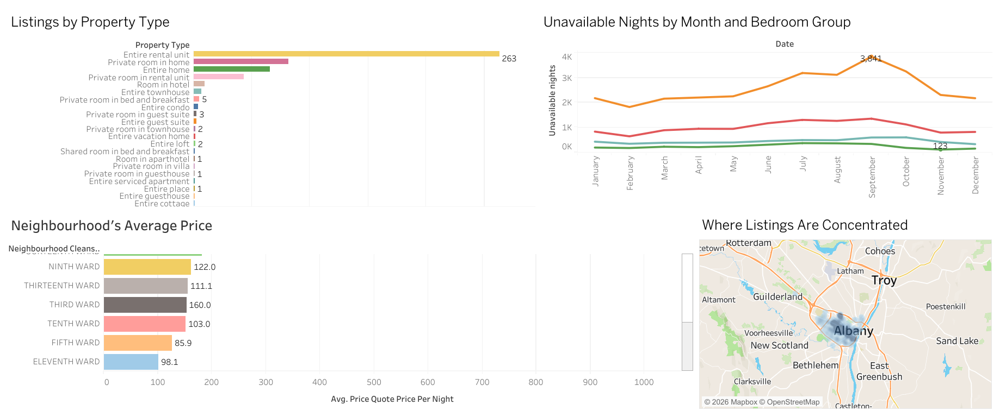

# Airbnb Market Analysis Dashboard (Tableau)

## Overview
Interactive Tableau dashboard analyzing Airbnb listings by location,
property type, price and monthly unavailability.

## Live Dashboard
(https://public.tableau.com/app/profile/mohamed.hasith/viz/AirBnb-DataVisualization/Dashboard1?publish=yes)

## Preview

## Questions Answered
- What types of properties are listed most often?
- Which neighbourhoods have the highest prices?
- Which months have the most unavailable nights, and does it differ by bedroom count?
- Where are listings concentrated on the map?

## Tools
Tableau Public

## Data
Files used: listings and calendar data

## Key Insights
- Entire rental units are the most common listing type, with 263 listings
- Unavailable nights peak in September

## Notes
Unavailable nights are used as a proxy for bookings, because the calendar
data shows availability, not confirmed reservations.
